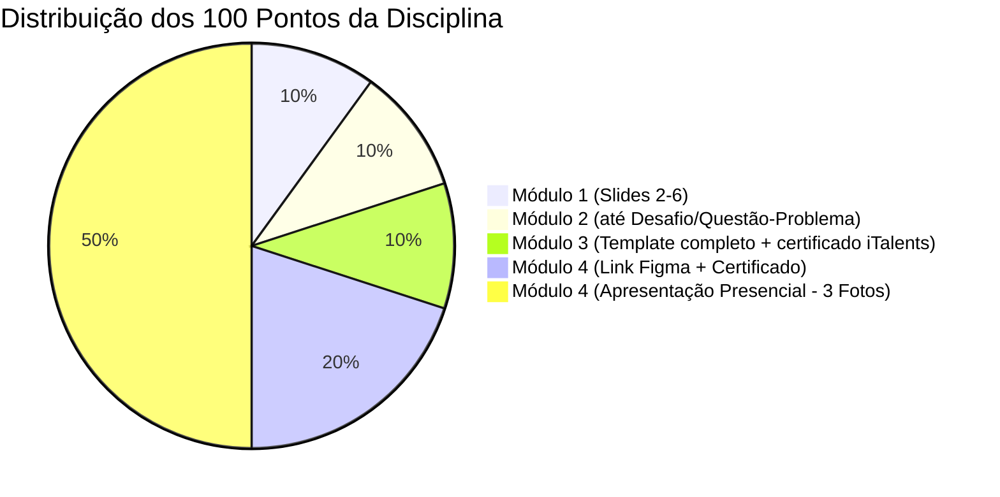

# Guia de conferência das entregas — APEX V (Banco de Dados / Unyleya)
> **Referência de apoio, não documento oficial.** Pesos, sequência e prazos devem ser confirmados no AVA; o status de cada atividade é o que aparece no portal.
> **Não copie os textos-modelo antigos deste arquivo para a submissão sem revisão.** Use o PowerPoint revisado e `REVISAO_ADEQUACAO_APEX_V.md`; há exemplos históricos que não são fatos do projeto.
## Projeto de Extensão: *Performa Solar IA — Inteligência Artificial Ética na Gestão de Energia Limpa*

> **Empresa / Local de Aplicação**: Performa Energy (Gestão de Créditos de Energia Solar)  
> **Tema Gerador**: O impacto da Inteligência Artificial (IA) no cotidiano e nas carreiras de TI  
> **Objetivos da ONU (ODS)**: ODS 7 (Energia Limpa e Acessível), ODS 9 (Indústria, Inovação e Infraestrutura) e ODS 13 (Ação Climática)  
> **Média Mínima para Aprovação**: 60 pontos (de 100). **Não há prova final!**

---

## 1. Visão Geral das Pontuações e Prazos

| Módulo | Entregável (conferir atividade aberta) | Pontuação do roteiro consultado | Observação |
|:---|:---|:---:|:---|
| **Módulo 1** | 1ª etapa dos slides | 10 pts | A tentativa aparecia ausente no portal consultado. |
| **Módulo 2** | 2ª etapa parcial, até o slide “Desafio/Questão-Problema Identificada” | 10 pts | Conferir enunciado ao liberar; não assumir conteúdo além do roteiro. |
| **Módulo 3** | 3ª etapa: envio do template completo + certificação do curso Figma | 10 pts | Conferir anexos/formato solicitado na sala. |
| **Módulo 4 (Envio 1)** | Produto Figma + certificado, conforme enunciado | 20 pts | Criar arquivo/link real e certificado verdadeiro, se solicitado. |
| **Módulo 4 (Envio 2)** | Apresentação presencial e evidências | 50 pts | Confirmar formato/rubrica no AVA; fotos apenas após atividade real e autorizada. |

---

## 2. Conteúdo Slide a Slide para o PowerPoint (`.pptx`)
*Copie os textos abaixo diretamente nos campos correspondentes do arquivo `TEMPLATE PADRÃO...pptx`.*

### ETAPA 1 (Módulo 1 — Slides 2 a 6)

#### Slide 2: Identificação do Curso e Título
* **Curso Superior**: Tecnologia em Banco de Dados (conforme portal do aluno)
* **Título do Trabalho**: *Inteligência Artificial, Ética e Governança de Dados na Gestão de Energia Solar: Letramento Digital e Proteção de Dados na Performa Energy*

#### Slide 3: Apresentação
* **Discente**: Rafael Silva
* **Matrícula**: [Seu Número de Matrícula]
* **Orientadora**: Profa. Dra. Carla Corrêa Tavares dos Reis

#### Slide 4: Disciplina e Ementa
* **Disciplina**: AMBIENTE PROFISSIONAL E DE EXTENSÃO - APEX V
* **Ementa**: *Problematização de temas conectados com a vida real na sociedade atual para solução por meio de projetos. Estabelecimento de direcionamentos e regras para a realização do desafio. Desenvolvimento de soft skills como trabalho em equipe, resolução de problemas complexos, comunicação, criatividade, entre outros. Tradução dos conhecimentos científicos para a comunidade. Inteligência Artificial: desafios e oportunidades. Programa de Extensão Institucional como proposta de diálogo entre a comunidade acadêmica e sociedade. Produção de materiais educacionais com uso das mídias digitais.*

#### Slide 5: Tema Gerador e Alinhamento aos ODS
* **Texto Sugerido**:
> O avanço acelerado da Inteligência Artificial transforma setores produtivos e a relação dos cidadãos com a tecnologia. Na transição energética sustentável, a gestão de créditos de energia solar distribuída exige análise contínua de grandes volumes de faturas e dados de consumo elétrico.
> 
> O presente projeto de extensão alinha-se prioritariamente ao **ODS 7 (Energia Limpa e Acessível)** e ao **ODS 9 (Indústria, Inovação e Infraestrutura)**, conectando-se também ao **ODS 13 (Ação contra a Mudança Global do Clima)**. A aplicação de ferramentas de IA (leitura automatizada de faturas via OCR, cálculo preditivo de compensação solar e assistentes virtuais explicáveis) permite democratizar o acesso à energia renovável por assinatura, assegurando transparência tarifária, eficiência de processos e conformidade ética no uso de algoritmos preditivos.

#### Slide 6: Local de Implementação
* **Nome do Local**: **Performa Energy**
* **Apresentação**: Empresa de tecnologia e soluções sustentáveis especializada em gestão e compensação de créditos de energia solar compartilhada, facilitando a redução de custos de energia para residências e empresas sem necessidade de instalação de painéis fotovoltaicos no local.
* **Local**: Performa Energy; confirmar endereço, espaço e autorização antes da atividade.
* **Público Atendido**: Colaboradores das áreas operacionais, análise de faturas, consultoria comercial e atendimento ao cliente, além de consumidores finais atendidos pela empresa.
* *(Dica: Insira uma foto da fachada, recepção ou do escritório da Performa Energy neste slide).*

---

### ETAPA 2 (Módulo 2 — até o slide “Desafio/Questão-Problema Identificada”)

#### Slide 8: Participantes da Comunidade
*(Atenção: Conforme instrução expressa da professora, não coloque nomes pessoais de indivíduos, apenas setores e funções).*
* **Cargos e Funções Envolvidos**:
  1. *Analistas de Operações e Faturas*: Responsáveis pela conferência de contas de energia, cálculo de saldos de créditos e compensação tarifária.
  2. *Consultores Comerciais de Energia Solar*: Profissionais que realizam simulações de propostas e atendimento inicial aos clientes.
  3. *Analistas de Suporte / Atendimento (Customer Success)*: Equipe de contato direto para tirar dúvidas sobre a fatura de energia e créditos solares.
  4. *Gestores de TI e Operações*: Liderança responsável por inovação, conformidade com a LGPD e governança tecnológica.

#### Slide 9: Desafio / Questão Problema Identificada
* **Texto Sugerido**:
> **Problema a investigar com a comunidade:** em atividades de gestão de créditos de energia solar, faturas e dados pessoais exigem cuidado. A oficina pode discutir riscos gerais de compartilhamento de documentos com IA e possíveis erros de leitura, sem afirmar que essas práticas ou falhas ocorreram na Performa Energy antes de confirmação.
> 1. **Privacidade**: faturas podem conter dados pessoais; usar exemplos fictícios ou anonimizados e avaliar ferramentas antes de compartilhar dados.
> 2. **Confiabilidade**: sistemas de IA/OCR podem interpretar valores incorretamente; qualquer resultado deve ser conferido em fonte confiável.
> 
> **Proposta de Solução**: Criar um material educativo e protótipo digital (*Performa Solar IA*) que demonstre o uso ético da IA, ensinando a equipe a realizar a higienização prévia de dados pessoais, utilizar prompts auditados e validar cálculos com supervisão humana (*Human-in-the-Loop*).

#### Slide 10: Aprofundamento Teórico (Armas de Destruição Matemática - ADMs)
* **Texto Sugerido**:
> Conforme teorizado por Cathy O'Neil em *Armas de Destruição Matemática (ADMs)*, modelos algorítmicos opacos e sem transparência tendem a criar ciclos viciosos de discriminação e exclusão social. No setor de crédito e energia, a adoção acrítica de modelos preditivos "caixa-preta" para seleção de clientes pode excluir consumidores de certas regiões com base em variáveis enviesadas.
> 
> Portanto, a inteligência artificial aplicada à energia deve considerar transparência, avaliação de riscos e supervisão adequada. O art. 20 da LGPD trata da revisão de decisões tomadas unicamente com base em tratamento automatizado que afetem interesses do titular; não se deve generalizar esse dispositivo para toda saída de IA.

---

### ETAPA 3 (Módulo 3 — envio do template completo; verificar conteúdo específico no AVA)

#### Slides 12 e 13: Planejamento Pedagógico e Ações
* **Mídia Digital a desenvolver**: material educativo/protótipo conceitual a construir no Figma. O HTML local existente e esta especificação não comprovam a entrega de um arquivo Figma.
* **Conteúdos Abordados**:
  1. O que é IA Generativa e limitações práticas (prevenção a alucinações de dados).
  2. Boas práticas de LGPD na manipulação de faturas e documentos de clientes.
  3. Leitura inteligente de faturas com OCR e validação assistida (*Human-in-the-loop*).
  4. Simulação explicável de créditos solares e impacto ambiental (ODS 7 e 13).
  5. Diretrizes da ANEEL (Lei 14.300/2022) em assistentes virtuais de atendimento.
* **Passo a Passo da Atividade**:
  - *Etapa 1*: Diagnóstico inicial dos desafios de dados na Performa Energy.
  - *Etapa 2*: Estruturação da arquitetura e das telas do protótipo no Figma.
  - *Etapa 3*: Realização de Workshop Presencial com os colaboradores na sede da empresa.
  - *Etapa 4*: Dinâmica prática de teste de usabilidade e preenchimento dos formulários de avaliação de impacto.

#### Slides 14 e 15: Material Educativo Digital (Telas do Figma)
* **Link para acesso**: inserir somente após criar o arquivo no Figma e testar a permissão pública.
* **Descrição do Material**:
  - *Tela 1 - Onboarding*: Apresentação do propósito sustentável e consentimento LGPD em linguagem simples.
  - *Tela 2 - Diagnóstico com OCR*: Área de upload da conta de luz com caixas delimitadoras coloridas mostrando a extração dos valores e campos para conferência humana.
  - *Tela 3 - Simulador de Créditos*: Gráfico comparativo de economia mensal/anual e redução de emissões de CO2 com botão "Como a IA calculou" (transparência matemática).
  - *Tela 4 - Assistente Lia*: Chatbot inteligente treinado nas normas da ANEEL com citação de fontes legais e botão de escalonamento para atendimento humano.
  - *(Insira capturas de tela das páginas do protótipo nestes dois slides)*.

#### Slide 16: Registros da Atividade Presencial (AS 3 FOTOS OBRIGATÓRIAS)
* Espaço reservado para as fotos da apresentação na Performa Energy:
  - **Foto 1**: Você de pé apresentando o projeto na sala de reuniões com os colaboradores.
  - **Foto 2**: Você ao lado da tela do computador mostrando o protótipo do Figma para os colegas.
  - **Foto 3**: Colaboradores sentados preenchendo as fichas de avaliação.

#### Slide 17: Autoavaliação do Discente
* **Texto Sugerido**:
> A realização deste projeto de extensão consolidou uma ponte essencial entre os conhecimentos teóricos de TI e o impacto social na comunidade corporativa da Performa Energy. 
> 
> Pude articular disciplinas fundamentais do curso — como Engenharia de Software, Segurança da Informação, Modelagem de Sistemas e Design de Interfaces (UI/UX) — com a prática de mercado e a responsabilidade socioambiental expressa nos ODS 7, 9 e 13. O desenvolvimento da atividade aprimorou competências socioemocionais (*soft skills*), como liderança, didática, comunicação assertiva e capacidade de traduzir conceitos complexos de IA em soluções práticas para os colaboradores. Constatou-se que a extensão universitária transforma o estudante em um agente proativo de inovação ética.

#### Slide 18: Avaliação da Comunidade Atendida
* **Avaliação da comunidade**: preencher depois da atividade com número real de respondentes e resultados calculados a partir das fichas. Não inserir médias estimadas.
* **Depoimento**: usar apenas fala real, autorizada e anonimizada. Se não houver autorização, omitir.

#### Slide 19: Referências Bibliográficas (Normas ABNT NBR 6023)
* BRASIL. **Lei nº 13.709, de 14 de agosto de 2018**. Lei Geral de Proteção de Dados Pessoais (LGPD). Brasília, DF: Presidência da República, 2018.
* BRASIL. **Lei nº 14.300, de 6 de janeiro de 2022**. Marco legal da micro e minigeração distribuída. Brasília, DF: Presidência da República, 2022.
* O'NEIL, Cathy. **Armas de destruição matemática**: como o big data aumenta a desigualdade e ameaça a democracia. Santo André: Editora Rua do Sabão, 2020.
* ORGANIZAÇÃO DAS NAÇÕES UNIDAS. **Transformando nosso mundo: a Agenda 2030 para o Desenvolvimento Sustentável**. Nova York: ONU, 2015.
* RUSSELL, Stuart; NORVIG, Peter. **Inteligência artificial**: uma abordagem moderna. 4. ed. Rio de Janeiro: GEN LTC, 2022.

---

## 3. O Guia das 3 Fotos Presenciais (Garantia dos 50 Pontos)

> [!IMPORTANT]
> A atividade presencial e as fotos são requisitos da entrega indicados no roteiro. Conferir no AVA os critérios/pontuação vigentes. Fotografar somente com autorização e sem expor dados pessoais.

1. **Foto 1 (Ambiente Geral)**:
   - **Como tirar**: Uma foto aberta da sala de reuniões ou do espaço de trabalho na Performa Energy.
   - **O que precisa aparecer**: Você em pé de frente para a equipe, os colegas sentados ouvindo e a tela do computador ou TV ao fundo com o slide inicial do trabalho aberto.
2. **Foto 2 (Demonstração do Figma)**:
   - **Como tirar**: Uma foto mais próxima da mesa/computador.
   - **O que precisa aparecer**: A tela do computador com o protótipo do Figma aberto e legível, com você apontando ou mostrando os recursos para um ou mais colegas da empresa.
3. **Foto 3 (Coleta da Avaliação)**:
   - **Como tirar**: Uma foto dos colaboradores preenchendo as folhas ou assinando a declaração.
   - **O que precisa aparecer**: Os colegas com caneta na mão assinalando as respostas da ficha de avaliação impressa sobre a mesa.
